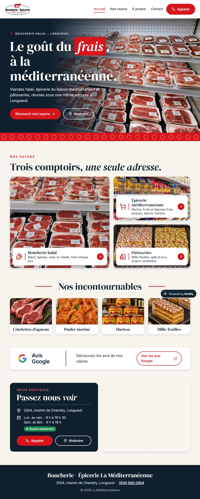

# La Méditerranéenne

Site vitrine d'une boucherie halal, épicerie méditerranéenne et pâtisserie à Longueuil (Québec), réalisé avec Angular à partir d'une maquette mobile et desktop.

**Site en ligne : [la-mediterraneenne.netlify.app](https://la-mediterraneenne.netlify.app)**

<table>
  <tr>
    <th>Desktop</th>
    <th>Mobile</th>
  </tr>
  <tr>
    <td valign="top"></td>
    <td valign="top"></td>
  </tr>
</table>

## Technologies

- **Angular 20** : composants standalone, signals
- **TypeScript**
- **CSS** : mobile-first, variables CSS, Grid et Flexbox, nommage BEM
- **Netlify** : hébergement et déploiement continu

## Fonctionnalités

- Page d'accueil complète : header avec menu burger sur mobile, hero, rayons, produits incontournables, avis Google, infos pratiques et footer
- Mise en page responsive, pensée d'abord pour le mobile
- Badge **« Ouvert maintenant » / « Fermé »** calculé selon les horaires du magasin, à l'heure de Montréal (`America/Toronto`) peu importe où se trouve le visiteur, et mis à jour chaque minute
- Boutons d'appel direct (`tel:`) et d'itinéraire vers la fiche Google Maps
- Plan Google Maps intégré
- Images optimisées en WebP avec chargement différé (`loading="lazy"`)
- Attention à l'accessibilité : balises sémantiques, textes alternatifs, icônes décoratives masquées aux lecteurs d'écran, contrastes vérifiés

## Organisation du projet

```
src/app/
├── layout/      # éléments présents sur toutes les pages
│   ├── header/
│   └── footer/
└── sections/    # sections de la page d'accueil
    ├── hero/
    ├── rayons/
    ├── incontournables/
    ├── avis/
    └── infos/
```

## Méthode de travail

- Une branche par section (`feature/hero`, `feature/rayons`, ...), fusionnée dans `main` par pull request
- Commits au format [Conventional Commits](https://www.conventionalcommits.org/fr/) (`feat`, `fix`, `chore`, `docs`)
- Déploiement automatique sur Netlify à chaque fusion dans `main`, avec un aperçu en ligne pour chaque pull request

## Lancer le projet

Prérequis : Node.js 22 ou plus récent.

```bash
npm install
npm start
```

Le site est ensuite disponible sur `http://localhost:4200`.

Pour générer la version de production :

```bash
npm run build
```

## À venir

- Pages Boucherie, Épicerie, Pâtisseries, Promotions, À propos et Contact
- Remplacer la harissa par la rechta dans les incontournables
